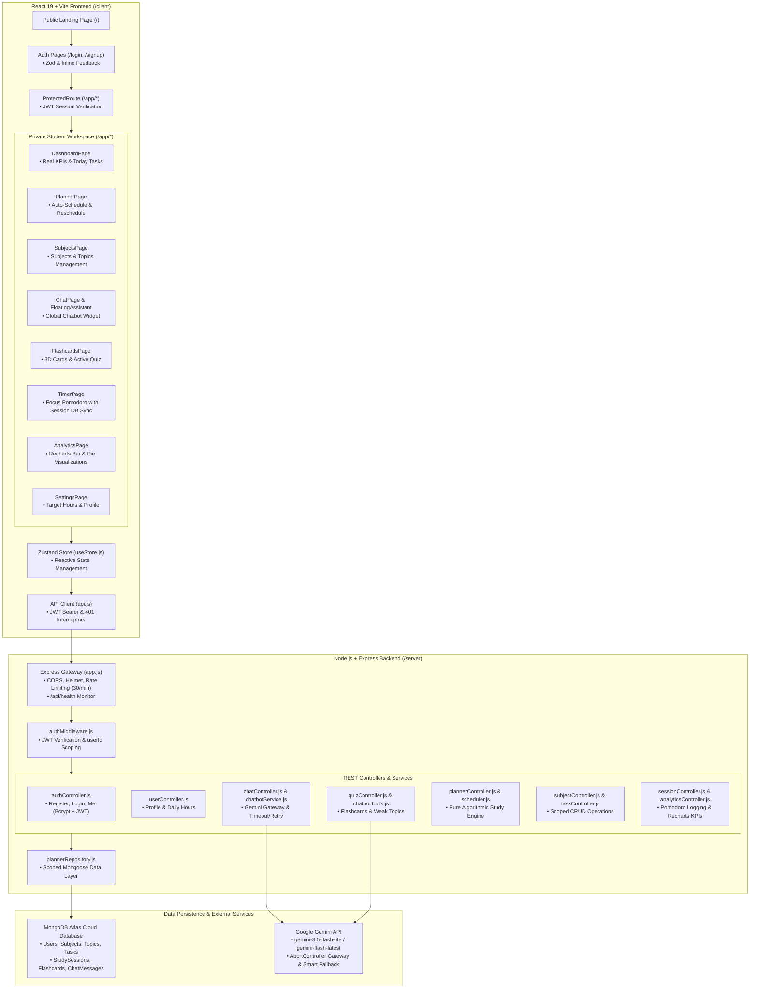

# StudyBuddy — System Architecture & Implementation Specifications

This document outlines the end-to-end multi-user system architecture of **StudyBuddy**, detailing the React 19 client, Node/Express backend, MongoDB Atlas persistence layer, and Google Gemini AI gateway.

---

## 1. System Architecture Diagram (Mermaid)

---

## 2. Layer Specifications

### 2.1 Presentation Layer (Frontend)
- **Framework**: React 19 with Vite 8 bundling.
- **Routing**: React Router 7 with route segregation:
  - **Public Routes**: `/` (Marketing Landing), `/login` (Sign in), `/signup` (Sign up).
  - **Protected Routes**: `/app/*` wrapped by `ProtectedRoute`. Unauthenticated visitors are redirected to `/login` with `from` location state preserved.
- **State Management**: Zustand store (`useStore.js`) maintaining authenticated user identity, active subjects, scheduled tasks, flashcard decks, and floating assistant state.

### 2.2 Application & Business Logic Layer (Backend)
- **Runtime**: Node.js 25 (ES Modules) with Express 4.
- **Security & Gateway**:
  - `helmet`: HTTP header hardening.
  - `cors`: Configured strictly for client domain.
  - `express-rate-limit`: 30 requests per minute on `/api/chat` to protect against burst spam.
  - `authMiddleware.js`: Validates standard `Authorization: Bearer <token>` headers, extracts `req.user.userId`, and rejects invalid/expired tokens with HTTP 401.
- **Auto-Scheduler Engine (`server/services/scheduler.js`)**:
  - Pure function receiving subjects, topics, overdue tasks, and daily hour constraints.
  - Computes topic priority: $\text{Weight} = \text{Difficulty} \times \text{EstimatedHours}$.
  - Urgency boost: Higher priority for closer exam deadlines.
  - Revision buffer: Automatically reserves revision tasks 1–2 days prior to exam date.
  - Exam boundary check: Topics are never scheduled on or after their exam date.
  - Two-phase execution: Supports simulation (`commit: false`) and database persistence (`commit: true`).

### 2.3 AI & Tutor Engine (`server/services/chatbotService.js`)
- **Model**: Google Gemini (`gemini-3.5-flash-lite`).
- **Resilience Policy**:
  - `AbortController` timeout (15,000ms default, configurable via `LLM_TIMEOUT_MS`).
  - Exactly one retry on transient failures (HTTP 429, 5xx, timeouts, network drops).
  - Instant deterministic fallback tutor response on fatal failures (guarantees zero HTTP 500 errors to client).
- **Tool Calling Architecture**:
  - 4 server-validated tools: `get_today_plan`, `create_task`, `reschedule_missed`, `generate_flashcards`.
  - Tools execute **exclusively** when emitted by the model as structured function calls.
  - Delimited boundary enforcement (`<<<STUDENT_INPUT>>>`, `<<<PLANNER_CONTEXT>>>`, `<<<TOOL_RESULT>>>`).
  - Capped at 3 tool iterations per conversational turn.

### 2.4 Persistence Layer (Database)
- **Host**: MongoDB Atlas Cloud Cluster.
- **ODM**: Mongoose 8 with strict schemas, timestamps, and compound indexing on `userId`.
- **In-Memory Testing**: `mongodb-memory-server` creates ephemeral, isolated databases during Jest and Vitest test runs, guaranteeing zero test pollution on production Atlas collections.
