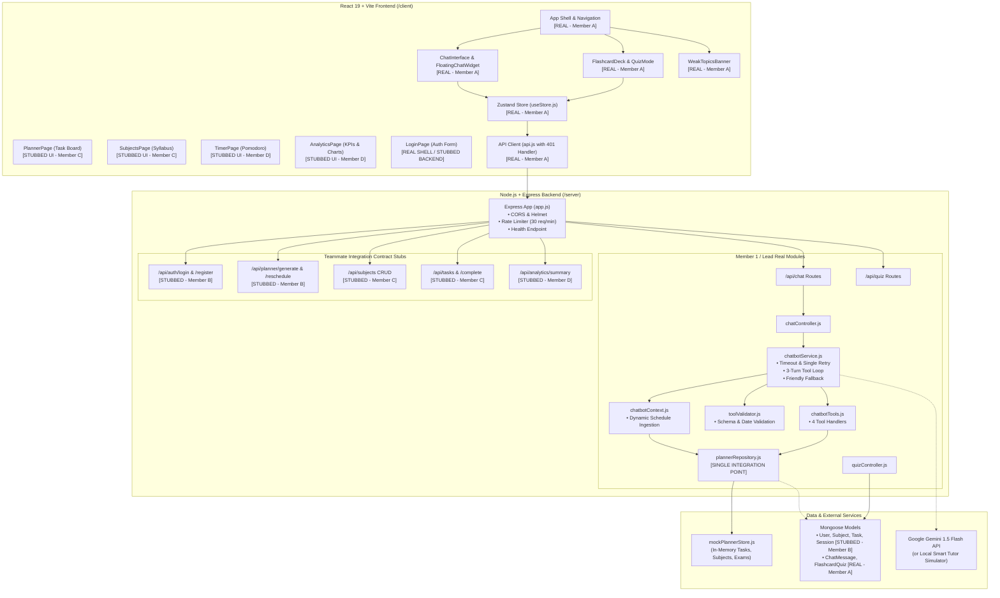

# StudyBuddy — System Architecture & Implementation Boundaries

This document provides a comprehensive view of the **StudyBuddy** system architecture as implemented in the current codebase, highlighting real production modules vs. integration stubs.

---

## 1. System Architecture Diagram (Mermaid)

---

## 2. Implementation Status by Component

| Module / Layer | Component Path | Owner | Status | Details |
|---|---|:---:|:---:|---|
| **Chatbot Core** | `server/services/chatbotService.js` | Member A | **REAL** | AbortController 15s timeout, single retry on 429/5xx, fallback tutor, 3-turn tool loop |
| **Tool Execution** | `server/services/chatbotTools.js` | Member A | **REAL** | `get_today_plan`, `create_task`, `reschedule_missed`, `generate_flashcards` |
| **Tool Security** | `server/services/toolValidator.js` | Member A | **REAL** | Type validation, length caps, ISO date formatting, bounds checking |
| **Context Ingestion** | `server/services/chatbotContext.js` | Member A | **REAL** | Delimited data injection, calendar midnight difference for exam countdowns |
| **Integration Boundary**| `server/services/plannerRepository.js` | Member A | **REAL** | Clean data abstraction decoupling chatbot from database schemas |
| **Flashcards & Quiz** | `client/src/components/flashcards/` | Member A | **REAL** | 3D interactive flip deck, multiple-choice quiz, weak-topic flagging |
| **App Shell & Nav** | `client/src/components/layout/` | Member A | **REAL** | Responsive sidebar, navbar, protected route, global floating chat widget |
| **Client Test Setup** | `client/src/test/smoke.test.jsx` | Member A | **REAL** | Vitest + React Testing Library smoke suite with 4 passing tests |
| **Authentication** | `server/app.js` (stubs), `models/User.js` | Member B | **STUBBED** | Express stub routes return mock token; real bcrypt/JWT pending Member B |
| **Data Models** | `server/models/` | Member B | **PARTIAL** | `ChatMessage` and `FlashcardQuiz` real; `Subject`, `Task`, `User` pending Member B |
| **Auto-Scheduler** | `/api/planner/generate` | Member B | **STUBBED** | Stub endpoint returns simulated rebalancing |
| **Calendar Grid UI** | `client/src/pages/PlannerPage.jsx` | Member C | **STUBBED** | Task board column preview wrapped in `TeammateModuleStub` |
| **Syllabus CRUD UI** | `client/src/pages/SubjectsPage.jsx` | Member C | **STUBBED** | Subject list preview wrapped in `TeammateModuleStub` |
| **Timer Logging** | `client/src/pages/TimerPage.jsx` | Member D | **STUBBED** | Local Pomodoro countdown with stub banner; session logging pending Member D |
| **Analytics Recharts**| `client/src/pages/AnalyticsPage.jsx` | Member D | **STUBBED** | KPI preview wrapped in `TeammateModuleStub`; Recharts pending Member D |

---

## 3. Teammate Swap-In Protocol

Member B can replace the in-memory store with MongoDB in one step:
1. Open [`server/services/plannerRepository.js`](file:///Users/monika/fsd%20project/server/services/plannerRepository.js).
2. Replace `mockTasks.filter(...)` with `await TaskModel.find({ userId })`.
3. Replace `mockSubjects.map(...)` with `await SubjectModel.find({ userId })`.
4. Zero changes will be required in `chatbotService.js`, `chatbotTools.js`, `chatbotContext.js`, or the frontend!

