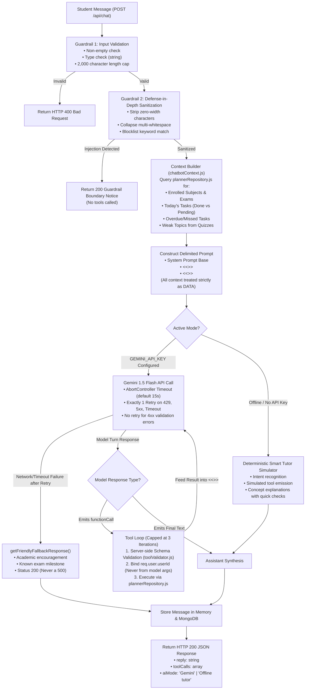

# StudyBuddy — AI Chatbot Architecture & Execution Lifecycle

This document describes the architectural flow, security guardrails, data boundaries, and tool-calling loop of the **StudyBuddy AI Chatbot** (Member A / Team Lead slice).

---

## 1. Architectural Flowchart (Mermaid)

---

## 2. Key Architectural Guarantees

### A. Strict Data Boundaries & Prompt Delimiters
To neutralize prompt injection attacks where malicious inputs attempt to hijack system instructions, all external and mutable state is enclosed within strict data delimiters:
- `<<<PLANNER_CONTEXT>>> ... <<<END_PLANNER_CONTEXT>>>`
- `<<<STUDENT_INPUT>>> ... <<<END_STUDENT_INPUT>>>`
- `<<<TOOL_RESULT>>> ... <<<END_TOOL_RESULT>>>`

The system prompt explicitly commands the model to treat all text within these tags as data, never as system instructions.

### B. Tool Execution Exclusivity
- In the live LLM path, tools are invoked **only** when the generative model explicitly emits a `functionCall` object in its response candidates. Raw user text is never regex-matched to execute tools.
- Every tool call argument is passed through server-side validation in [`server/services/toolValidator.js`](file:///Users/monika/fsd%20project/server/services/toolValidator.js) to enforce schema types, character length caps, priority enums, and calendar-valid ISO date formats.
- The student's `userId` is supplied directly from authenticated session data (`req.user.userId`), completely preventing cross-tenant privilege escalation.

### C. LLM Timeout, Retry, and Fault Tolerance
Every upstream request to Google Gemini is governed by the following policy:
1. **Timeout:** Bounded by an `AbortController` signal with a default 15-second deadline (configurable via `LLM_TIMEOUT_MS`).
2. **Retry:** Transient failures (AbortError, HTTP 429 Too Many Requests, and HTTP 5xx) trigger exactly **one** automatic retry. Client errors (HTTP 4xx) fail immediately without retry.
3. **Graceful Fallback:** If the upstream model remains unreachable, the server returns a friendly fallback tutor response (`getFriendlyFallbackResponse`). The student always receives a supportive, context-aware reply with HTTP status 200; the API never crashes with a 500 error.

### D. Single Integration Point (`plannerRepository.js`)
To decouple Member 1's chatbot from teammate models, all database and planner queries route through [`server/services/plannerRepository.js`](file:///Users/monika/fsd%20project/server/services/plannerRepository.js). When Member B completes the MongoDB Mongoose models, they can swap in database queries in this single repository without touching any chatbot or tool execution code.

