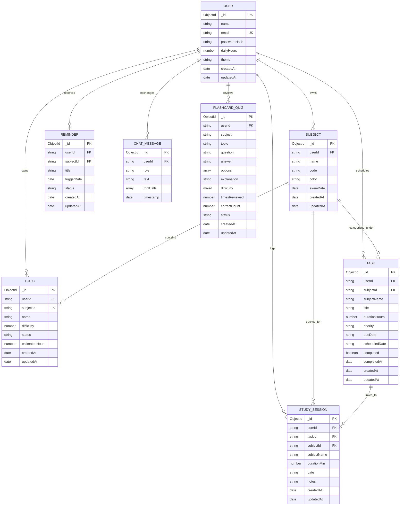

# StudyBuddy — Entity-Relationship (ER) Diagram & Schema Specification

This document details the database architecture of StudyBuddy, implemented via **MongoDB Atlas** and **Mongoose ODM**. Every domain entity is strictly scoped to an authenticated `User` record via `userId` to enforce zero cross-tenant data leakage.

---

## 1. Visual Entity-Relationship Diagram

---

## 2. Collection Schemas & Indexing Strategy

### 2.1 User Collection (`users`)
- **Primary Identifier**: `_id` (`ObjectId`)
- **Indexes**:
  - `email`: Unique index `{ email: 1 }` (enforces unique registrations).
- **Purpose**: Stores student profiles, daily study capacity limits (`dailyHours`), and UI preferences.

### 2.2 Subject Collection (`subjects`)
- **Primary Identifier**: `_id` (`ObjectId`)
- **Foreign Key**: `userId` (`String`, references `users._id`)
- **Indexes**:
  - Compound Index: `{ userId: 1, name: 1 }`
- **Purpose**: Represents academic courses (e.g., CS301 Data Structures). Contains optional `examDate` used by the scheduler for countdown calculation.

### 2.3 Topic Collection (`topics`)
- **Primary Identifier**: `_id` (`ObjectId`)
- **Foreign Keys**: `userId` (`String`), `subjectId` (`String`)
- **Indexes**:
  - Compound Index: `{ userId: 1, subjectId: 1, status: 1 }`
- **Difficulty Scale**: `1` (Easy), `2` (Medium), `3` (Hard).
- **Purpose**: Represents syllabus breakdown items with estimated hours and completion status.

### 2.4 Task Collection (`tasks`)
- **Primary Identifier**: `_id` (`ObjectId`)
- **Foreign Keys**: `userId` (`String`), `subjectId` (`String`)
- **Indexes**:
  - Compound Index: `{ userId: 1, scheduledDate: 1, completed: 1 }`
- **Date Format**: ISO Date Strings (`YYYY-MM-DD`) for deterministic timezone-invariant daily scheduling.
- **Purpose**: Daily actionable study and revision tasks generated by the auto-scheduler or created manually by the student or AI assistant.

### 2.5 StudySession Collection (`studysessions`)
- **Primary Identifier**: `_id` (`ObjectId`)
- **Foreign Keys**: `userId` (`String`), `subjectId` (`String`), `taskId` (`String`, optional)
- **Indexes**:
  - Compound Index: `{ userId: 1, date: 1 }`
- **Purpose**: Records completed Pomodoro focus intervals (duration in minutes, date, subject) powering the Recharts analytics charts.

### 2.6 ChatMessage Collection (`chatmessages`)
- **Primary Identifier**: `_id` (`ObjectId`)
- **Foreign Key**: `userId` (`String`)
- **Indexes**:
  - Compound Index: `{ userId: 1, timestamp: -1 }`
- **Purpose**: Persists tutor conversation history and tool action invocations for contextual continuity.

### 2.7 FlashcardQuiz Collection (`flashcardquizzes`)
- **Primary Identifier**: `_id` (`ObjectId`)
- **Foreign Key**: `userId` (`String`)
- **Indexes**:
  - Compound Index: `{ userId: 1, status: 1 }`
  - Compound Index: `{ userId: 1, topic: 1 }`
- **Status Enum**: `'unseen' | 'learning' | 'weak' | 'mastered'`
- **Purpose**: Active recall items generated via Google Gemini or curated fallbacks. Tracks review attempts and identifies weak topics.

---

## 3. Multi-Tenant Security & Isolation Guarantee

1. **Zero Global Data Leaks**: Every Mongoose query in `plannerRepository.js`, `subjectController.js`, `taskController.js`, `sessionController.js`, and `analyticsController.js` includes `{ userId: req.user.userId }`.
2. **Cascading Safety**: Deleting or updating documents verifies both the document `_id` and the matching `userId`. Attempts by User A to mutate User B's resources fail with 404 or 403.

